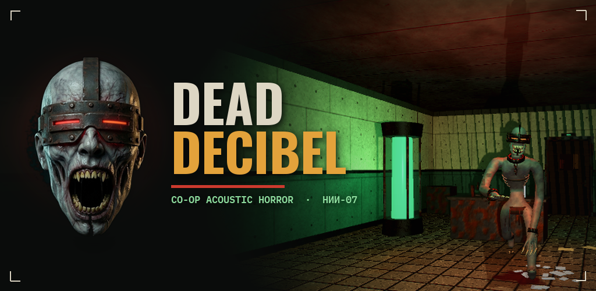
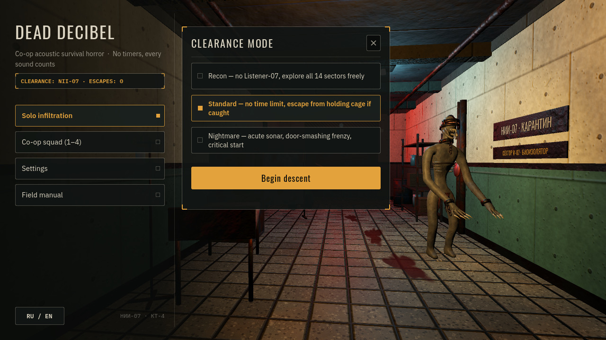
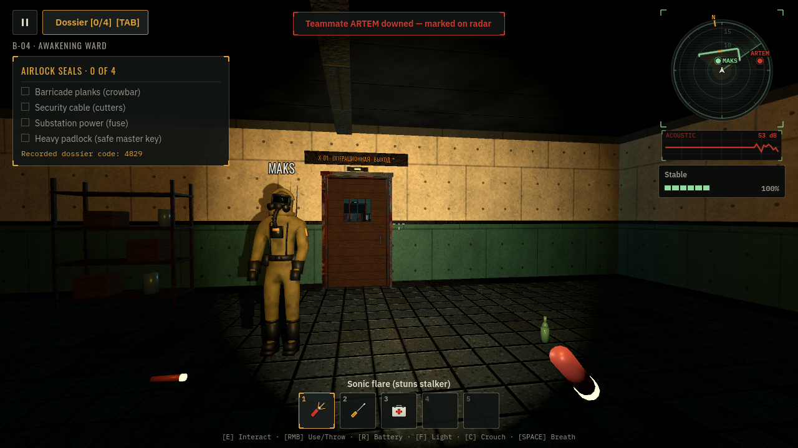
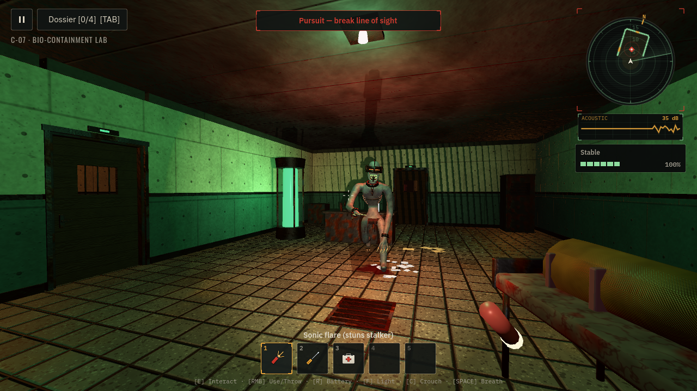
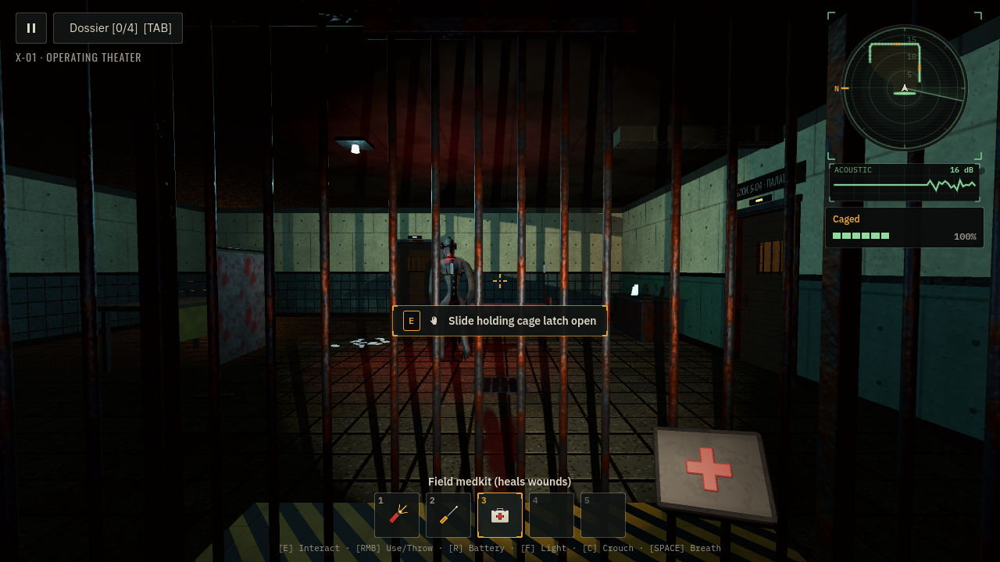
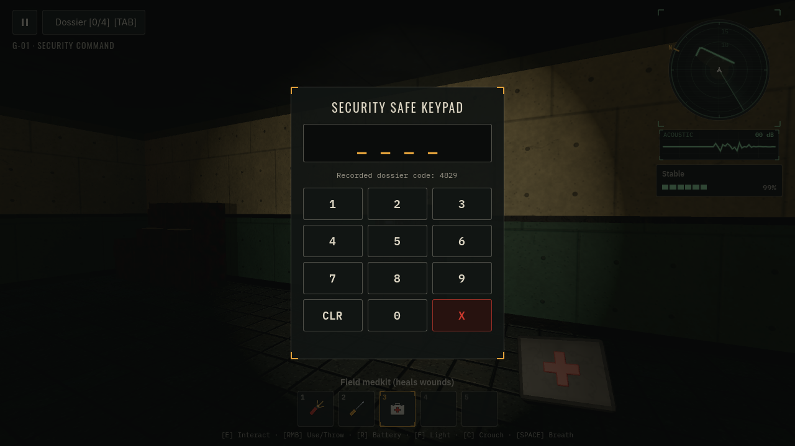

<p align="center">
  
</p>

<h1 align="center">DEAD DECIBEL / МЁРТВЫЙ ДЕЦИБЕЛ</h1>

<p align="center">
  <strong>1–4 Player Co-op &amp; Solo 3D Acoustic Survival Horror in an Abandoned Soviet Underground Bio-Institute (НИИ-07)</strong><br>
  <em>Кооперативный и одиночный 3D-хоррор на выживание со стелсом по звуку в заброшенном советском подземном НИИ-07</em>
</p>

<p align="center">
  <a href="#english">English</a> •
  <a href="#русский">Русский</a> •
  <a href="#screenshots">Screenshots</a> •
  <a href="#14-sector-complex">14 Sectors</a> •
  <a href="#co-op--proximity-voice-relay">Co-op &amp; Voice</a> •
  <a href="#build--testing">Build &amp; Tests</a> •
  <a href="https://r1laun.github.io/dead-decibel/">Privacy Policy</a>
</p>

---

<a id="english"></a>
## Overview (EN)

**DEAD DECIBEL** (`v4.1.0`) is a first-person 3D acoustic survival horror game built on **Godot 4.7** (`GL Compatibility`) for **Android** and **macOS**, paired with a zero-dependency **Node.js WebSocket relay** for 1–4 player co-op and real-time 3D proximity voice chat.

Trapped inside sealed underground Soviet medical research institute **НИИ-07**, you must stay quiet, monitor your decibel output and breath, outsmart the blind acoustic predator **Listener-07**, break all **4 security seals** on the North Evacuation Airlock, and escape alive—with **zero artificial day limits or countdown timers**.

### Key Mechanics

- **Real-Time Acoustic Stealth & Live Microphone Detection (`AcousticBus`)**:
  - Sprinting, opening/slamming doors, stepping on shattered glass, bumping hospital wheelchairs, and even **speaking into your real microphone** (`8 kHz` capture with automatic ambient noise-floor calibration) emit physical sound radii tracked on the CRT acoustic oscilloscope (`dB`).
  - **Hold Breath (`Space` / `LT`)**: Quiet your breathing and stabilize viewmodel/head sway while Listener-07 stalks nearby, managing breath stamina carefully.
- **Acoustic AI Predator — Listener-07 (`MonsterDirector`)**:
  - Multi-state stalker (`PATROL`, `ECHOLOCATE` sonar bone-click bursts, `INVESTIGATE` with multi-waypoint post-chase sweeps, `INSPECT_LOCKER`, `CHASE` with door bashing, `STUNNED`, `COOLDOWN`).
  - Dynamic crimson aura & proximity footstep micro-tremors within `9.0 m` (automatically disabled when **Reduce Motion** is enabled).
- **4 Airlock Evacuation Seals (No Time / Day Cap)**:
  1. **Oak Planks** — Pry off with the **Crowbar** (`Монтировка`).
  2. **High-Voltage Cable** — Sever with **Wire Cutters** (`Кусачки`).
  3. **380V Substation Power** — Restore power using the **Fuse** (`Предохранитель`) in `Э-380 / E-380`.
  4. **Master Padlock** — Decode the procedural 4-digit **Safe Code** (`Код-записка` + keypad in `О-01 / G-01`) to retrieve the **Master Key** (`Мастер-ключ`).
- **Tactical Tools, Hazards & Second Chances**:
  - **5-Slot Inventory**: Crowbar, Wire Cutters, Fuse, Master Key, Safe Code Note, Throwable Glass Bottles (acoustic decoys), Noise Flares (stun Listener-07), Batteries (`[R]` quick-reload + emergency dynamo floor so flashlight never permanently dies), Field Medkits (heal wounds), and Adrenaline Syringes (self-revive & speed surge).
  - **10 Lockers & Under-Desk Cover**: Peek through locker slats; use **4 PA Intercom Stations** across the facility to lure Listener-07 into distant wings.
  - **Holding Cage & Co-op SOS Crawl**: First capture in Solo locks you inside the Surgical Holding Cage (`Х-01 / X-01`) for a tense escape attempt; in Co-op, captured operatives enter a `90 s` downed SOS state (`beacon on CRT radar`) for teammate rescue or syringe self-revive.
- **3 Clearance Difficulties**:
  - **Practice** (no Listener-07, learn all 14 sectors freely)
  - **Standard** (full acoustic hunt & stealth)
  - **Nightmare** (start wounded, faster stalker speeds, `1.35×` hearing sensitivity)

---

<a id="screenshots"></a>
## Screenshots / Скриншоты

| Live 3D НИИ-07 Menu / Главное меню | Ward B-04 & CRT Sonar / Палата Б-04 и сонар |
| :---: | :---: |
|  |  |
| **Bio-Lab C-07 Chase / Погоня в Биолаборатории** | **Holding Cage & Safe Keypad / Изолятор и Сейф** |
|  |  |

<p align="center">
  
</p>

---

<a id="14-sector-complex"></a>
## 14-Sector Underground Complex `НИИ-07` (`FloorGenerator`)

The `64 m × 56 m` institute features two-tone Soviet institutional architecture, overhead ceiling ribs & pipes, stencilled bilingual/Cyrillic signage, **23 heavy doors**, **4 crawlspace vents** (unscrew with Screwdriver or force loudly), **16 searchable drawers**, **10 lockers**, **4 PA intercom lures**, and **33 AI navigation graph nodes**:

| Wing / Zone | Sector Code | English Name | Русское название |
| :--- | :---: | :--- | :--- |
| **South Wing** | `B-04` / `Б-04` | Awakening Ward | Палата пробуждения |
| **South Wing** | `B-05` / `Б-05` | Staff Canteen | Столовая персонала |
| **South Wing** | `P-01` / `П-01` | South Triage | Приёмный отсек |
| **South Wing** | `S-04` / `С-04` | Hazmat Warehouse | Склад химзащиты |
| **West Wing** | `X-01` / `Х-01` | Operating Theater & Cage | Операционная · Изолятор |
| **West Wing** | `M-02` / `М-02` | Autopsy Morgue | Патологоанатомия |
| **North Wing** | `K-03` / `К-03` | Cryo-Archive | Криоархив |
| **North Wing** | `A-00` / `Ш-00` | Evacuation Airlock (`EXIT`) | Северный шлюз (`ВЫХОД`) |
| **North Wing** | `E-380` / `Э-380` | Power Substation | Подстанция 380В |
| **East Wing** | `G-01` / `О-01` | Security Command (`Safe`) | Пост охраны (`Сейф`) |
| **East Wing** | `D-02` / `Д-02` | Decontamination | Санпропускник |
| **Central Core** | `C-07` / `Ц-07` | Bio-Containment Lab | Биолаборатория |
| **Central Core** | `C-08` / `Ц-08` | Observation Archive | Архив наблюдений |
| **Perimeter** | `R-N / S / W / E` | North / South / West / East Ring Galleries | Северная / Южная / Западная / Восточная галереи |

---

<a id="co-op--proximity-voice-relay"></a>
## 1–4 Player Co-op & Proximity Voice (`relay/`)

- **Zero-Dependency WebSocket Relay (`relay/server.mjs`)**: Pure Node.js HTTP + RFC 6455 WebSocket server (`PORT=8787` default) with 4-character room codes, public/private lobby discovery, and strict RAM-only message routing.
- **Full World & Late-Join Sync**: Friends can join **mid-match** and automatically receive the host's live world snapshot (open doors, vents, drawers, remaining pickups, airlock seal progress, holding cage lock state, and Listener-07 position).
- **3D Proximity Voice Chat**: Streams `8 kHz` mono 8-bit PCM packets (`AudioEffectCapture`) strictly in RAM across `Auto`, `Push-to-Talk [V]`, or `Off` modes.
- **Resilient Netcode**: `25 s` call-freeze grace period (`CALL_FREEZE_GRACE_MS`) for mobile app switches/calls plus automatic **Host Migration** if the room host disconnects.
- **macOS Quick Launchers**:
  - `Кооп на одном Mac.command` — launches the local relay + two game windows side-by-side (`ws://127.0.0.1:8787`, mics muted for local desk play).
  - `Мультиплеер по сети.command` — launches the relay + automatic LAN IP (`ws://<LAN_IP>:8787`) + optional `cloudflared` public `wss://` tunnel copied to clipboard.

---

## Controls / Управление

| Action | Desktop (Keyboard / Mouse) | Gamepad (Xbox / DualSense) | Mobile Touch |
| :--- | :--- | :--- | :--- |
| **Move / Look** | `WASD` / Arrows + Mouse | Left Stick / Right Stick | Floating Left Thumbstick + Screen Drag / Gyro |
| **Interact** | `E` or `LMB` | `A` / `X` | `88 px` Primary Interact Button |
| **Use / Throw Held Item** | `RMB` (or `G` / `Q` throw/drop) | `D-Pad Down` (drop/throw) | Drop / Use Touch Arc |
| **Quick Reload Battery** | `R` (uses any slot) | — | Equip / Use Battery |
| **Sprint / Crouch** | `Shift` / `C` or `Ctrl` | `L-Stick` (toggle) / `B` | Sprint / Crouch Buttons |
| **Hold Breath** | `Space` | `LT` | Breath Button |
| **Flashlight** | `F` | `Y` | Flashlight Button |
| **Inventory Slots** | `1–5` or Mouse Wheel | `LB` / `RB` | 5-Slot Bottom Hotbar |
| **Field Dossier / PTT** | `Tab` or `J` / `V` (PTT) | `Back` (Dossier) | Dossier Toggle / Auto or PTT |

Accessibility options in **Settings**: **Reduce Motion** (`SaveState.reduce_motion`, disables head-bob, camera trauma/tremors, UI pulses, and modal zoom tweens), **Haptics**, **Gyroscope Look**, **Sensitivity**, **Master Volume**, **Microphone Mode**, and **RU / EN Language Switch**.

---

<a id="build--testing"></a>
## Project Structure, Build & Automated Tests

```text
.
├── game/
│   ├── project.godot                 # Godot 4.7 project config (DEAD DECIBEL / МЁРТВЫЙ ДЕЦИБЕЛ)
│   ├── export_presets.example.cfg    # Sanitized Android APK / Play Store AAB export template
│   ├── DESIGN.md                     # НИИ-07 Soviet Field Instrument UI & architecture spec
│   ├── assets/                       # Oswald + IBM Plex fonts, 512x512 PBR textures, 128x128 icons, .glb rigs
│   ├── scenes/                       # main.tscn
│   ├── scripts/
│   │   ├── autoload/                 # loc.gd, save_state.gd, synth_audio.gd, acoustic_bus.gd, net_relay.gd
│   │   ├── monsters/                 # monster_director.gd
│   │   ├── player/                   # listener_player.gd, remote_listener.gd
│   │   ├── ui/                       # brutal_hud.gd, los_minimap.gd
│   │   └── world/                    # floor_generator.gd, asset_library.gd, game_session.gd
│   └── tests/                        # run_tests.gd, test_suite.tscn, mp_live.gd, mp_live.tscn
├── relay/
│   ├── server.mjs                    # Zero-dependency Node.js WebSocket co-op & voice relay
│   └── test_relay.mjs                # Relay protocol & host-migration test suite
├── tools/
│   ├── gen_textures_icons.py         # 512x512 seamless PBR textures & 128x128 SDF icons generator
│   ├── blender_sculpt_characters.py  # Blender procedural sculpting & NLA animation exporter (.glb)
│   ├── blender_build_models.py       # Facility prop .glb generator
│   └── blender_expand_world.py       # World prop generator
└── docs/                             # GitHub Pages privacy policy (index.html) & screenshots
```

### Run Locally

```bash
# 1. Start the co-op & proximity voice relay (optional for solo)
node relay/server.mjs

# 2. Launch the game in Godot 4.7+
godot --path game
```

### Build Android APK / Play Store AAB

> Note: Keep private Android keystores and credentials out of version control. `game/export_presets.cfg` is intentionally ignored/kept local; use `game/export_presets.example.cfg` as your template.

```bash
cp game/export_presets.example.cfg game/export_presets.cfg
# Fill in your local keystore/debug, keystore/release, keystore/release_user, and keystore/release_password

godot --headless --path game --import
godot --headless --path game --export-release "Android APK" ../builds/dead-decibel.apk
godot --headless --path game --export-release "Android Play Store AAB" ../builds/dead-decibel-playstore.aab
```

### Automated Verification

```bash
# 1. Relay WebSocket unit tests
node relay/test_relay.mjs

# 2. Godot asset import & headless verification suite
godot --headless --path game --import
godot --headless --path game res://tests/test_suite.tscn

# 3. Live two-process co-op integration test (host + late-join client over localhost WebSocket)
PORT=8799 node relay/server.mjs &
RELAY_PID=$!
HS=/tmp/mp_code.txt; rm -f "$HS"
MP_ROLE=host   MP_HANDSHAKE="$HS" MP_RELAY_URL=ws://127.0.0.1:8799 ECHO7_PLAYER_ID=MP-HOST \
  godot --headless --path game res://tests/mp_live.tscn &
MP_ROLE=client MP_HANDSHAKE="$HS" MP_RELAY_URL=ws://127.0.0.1:8799 ECHO7_PLAYER_ID=MP-CLIENT \
  godot --headless --path game res://tests/mp_live.tscn &
wait
kill "$RELAY_PID" 2>/dev/null || true
```

---

<a id="русский"></a>
## Описание проекта (RU)

**МЁРТВЫЙ ДЕЦИБЕЛ** (`DEAD DECIBEL`, `v4.1.0`) — кооперативный (1–4 игрока) и одиночный 3D-хоррор от первого лица на движке **Godot 4.7** (`GL Compatibility`) для **Android** и **macOS** с собственным WebSocket-ретранслятором на Node.js без внешних зависимостей.

Вы заперты на закрытом этаже советского подземного биоинститута **НИИ-07**. В мире нет таймера дней и обратного отсчёта: выживание зависит от тишины, контроля дыхания, тактического использования фонаря, шкафов и приманок, а также слаженной командной работы.

### Ключевые особенности

- **Настоящий стелс по звуку и живой микрофон (`AcousticBus`)**: бег, скрип дверей, битое стекло, медицинские коляски и реальный голос в микрофон (захват `8 кГц` в оперативной памяти RAM с калибровкой шумопорога) отображаются на ЭЛТ-осциллографе и привлекают **Слухача-07**.
- **Умный слепой хищник — Слухач-07 (`MonsterDirector`)**: патрулирует, пускает эхолокационные импульсы, зачищает соседние узлы после потери видимости, проверяет шкафы, выбивает двери и оглушается шумовыми фальшфейерами.
- **4 блокировки Северного шлюза (`Ш-00`)**: срыв досок монтировкой, перекусывание силового кабеля, запуск подстанции `380В` предохранителем и подбор/ввод 4-значного кода от сейфа на посту охраны (`О-01`) ради мастер-ключа.
- **Кооператив 1–4 игроков и 3D-рация (`relay/`)**: синхронизация мира даже при входе посреди вылазки, спасение раненого напарника (SOS-ползание и реанимация или освобождение из клетки изолятора в `Х-01`), 25-секундное окно переподключения и автоматическая миграция ведущего.

---

## Privacy Policy & Fonts

- **Live Privacy Policy (GitHub Pages):** [https://r1laun.github.io/dead-decibel/](https://r1laun.github.io/dead-decibel/) (source in [`docs/index.html`](docs/index.html))
- **Fonts:** `Oswald`, `IBM Plex Sans`, and `IBM Plex Mono` bundled under SIL Open Font License (`game/assets/fonts/OFL-*.txt`).
